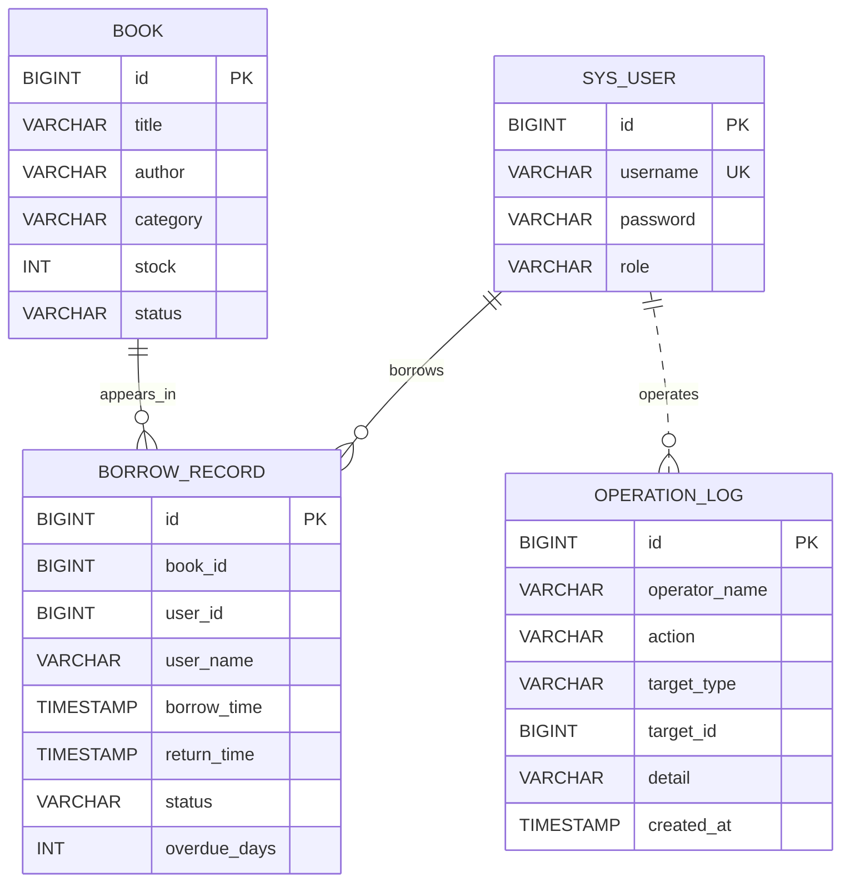

# 基于轻量级框架开发中小型系统——校园图书借阅管理系统工程实践报告

> 本报告整合项目的需求分析、系统设计、源码工程说明和测试报告，说明系统的目标、结构、技术选型、核心业务流程、数据流转、安全控制、运行方法及当前实现边界。项目定位为课程实践与框架整合学习 Demo，不以生产部署为目标。

## 1. 项目概述

### 1.1 实践主题

本项目以校园图书馆为业务场景，围绕“基于轻量级框架开发中小型系统”的实践要求，整合 Spring Boot、Spring MVC、MyBatis、Spring Security，完成一个具备基础业务流程、数据访问能力和角色访问控制的单体 Web 系统。

系统覆盖图书查询、学生借阅与归还、管理员图书维护、借阅记录查询和操作日志查询。通过模块化分层模拟图书资源、用户、借阅服务和管理审计之间的协同关系，体现从业务需求到接口、业务逻辑、数据库持久化和权限校验的完整工程链路��

### 1.2 项目目标

- 通过 Spring Boot 快速启动并配置应用。
- 通过 Spring MVC 暴露 REST 风格 HTTP API。
- 通过 MyBatis Mapper 接口和 XML SQL 访问关系数据。
- 通过 Spring Security 基于用户名和角色保护接口。
- 通过事务将借阅、库存变更、借阅记录和日志写入组织为一条业务流程。
- 保持项目小而清晰，适合阅读、运行和课程演示。

### 1.3 范围与约束

本项目采用单体应用和 H2 内存数据库，不包含前端框架、微服务、分布式缓存、消息队列、JWT 或复杂运维设施。应用重启后，H2 内存数据库中的数据会重新由初始化脚本生成。项目中的默认账号、性能数字和样例数据仅用于本地学习演示。

## 2. 需求分析

### 2.1 角色与权限

| 角色 | 主要能力 |
|---|---|
| 学生（STUDENT） | 查询图书、发起借阅、发起归还、查询自己的借阅记录 |
| 管理员（ADMIN） | 使用学生可用的图书及借阅接口；新增和更新图书；查询操作日志 |
| 未认证用户 | 不能访问受保护的业务接口 |

### 2.2 功能需求

1. 图书查询：支持查询全部图书、按书名/作者/分类关键词检索、按 ID 查看详情。
2. 图书管理：管理员可新增图书和更新图书信息。
3. 借阅管理：验证图书存在及库存，扣减库存，新增借阅记录并写入操作日志。
4. 归还管理：检查借阅记录，更新归还状态和时间，增加图书库存并写入操作日志。
5. 借阅记录：认证用户可查看与其账号关联的借阅记录。
6. 日志审计：管理员可查询操作日志，日志记录操作人、动作、目标和时间等信息。

### 2.3 非功能要求

- **轻量**：依赖和部署要求尽量少，使用本地 H2 数据库。
- **易理解**：按 Controller、Service、Mapper、数据库分层。
- **可演示**：提供初始化账号、图书样例和接口清单。
- **可扩展**：在不改变核心分层的情况下，后续可添加 DTO、分页、更多借阅规则和更完整的测试。

## 3. 全产业链协同思路

系统不是微服务或产业平台，而是借助单体内部的模块划分模拟业务链条协同：

| 协同环节 | 系统模块 | 业务作用 |
|---|---|---|
| 资源供给 | 图书信息管理 | 管理书目、分类和库存，提供可借阅资源 |
| 用户服务 | 用户与角色 | 区分学生和管理员，确定用户可以执行的业务 |
| 业务交易 | 借阅与归还 | 处理借出、归还、库存变化和借阅状态 |
| 质量治理 | 操作日志 | 记录关键业���行为，为追踪与管理提供依据 |
| 安全治理 | Spring Security | 在进入业务处理前检查身份和角色 |
| 数据支撑 | MyBatis 与 H2 | 持久化用户、图书、借阅记录和日志 |

由此形成“资源维护 → 用户访问 → 借阅交易 → 数据更新 → 日志审计”的闭环。该设计强调产业链上的角色协作与信息流转，但保持在一个可学习的单体应用范围内。

## 4. 技术架构与选型理由

### 4.1 分层架构


请求由客户端进入 Spring Security 过滤器链，认证和授权通过后进入 Spring MVC Controller。Controller 将请求转给 Service；Service 执行业务校验、事务控制和流程编排；Mapper 通过 XML 中的 SQL 访问 H2。日志由日志服务写入同一数据库。

### 4.2 技术选择

| 技术 | 项目中的职责 | 选择理由 |
|---|---|---|
| Spring Boot 3.2.5 | 应用启动、自动配置、依赖管理 | 减少样板配置，适合快速搭建可运行的 Java Web 项目 |
| Spring MVC | REST API 和请求路由 | 使用熟悉的 Controller 注解处理 HTTP 请求，便于展示 Web 请求链路 |
| MyBatis 3.0.3 | SQL 映射和数据库访问 | Mapper 接口配合 XML SQL，能直观看到 SQL 与 Java 方法的对应关系 |
| Spring Security | HTTP Basic 认证、角色访问控制 | 使用框架过滤器链和角色规则保护接口，避免自行实现认证拦截 |
| H2 | 本地关系型数据存储 | 无需单独安装数据库，应用启动时可初始化演示数据 |
| Maven | 依赖管理和构建 | 便于执行测试、打包和运行 |

## 5. 工程结构与模块职责

```text
src/main/java/com/demo/
├── LibraryDemoApplication.java       # Spring Boot 启动入口、Mapper 扫描
├── config/SecurityConfig.java        # Spring Security 配置
├── controller/                       # REST API 控制器
├── entity/                           # 数据实体
├── mapper/                           # MyBatis Mapper 接口
└── service/                          # 业务逻辑、事务和日志服务

src/main/resources/
├── application.yml                   # H2、MyBatis、服务端配置
├── schema.sql                        # 表结构初始化
├── data.sql                          # 演示用户和图书数据
└── mapper/                           # MyBatis XML SQL

docs/                                 # 需求、设计、工程和测试文档
```

- **启动类**：启动 Spring Boot，扫描 `com.demo.mapper` 下的 Mapper。
- **Controller**：映射 HTTP 路由、读取路径参数并返回结果。
- **Service**：维护业务规则；借阅与归还方法使用事务注解。
- **Mapper**：定义数据访问方法，XML 中编写查询、插入和更新 SQL。
- **Entity**：承载用户、图书、借阅记录和日志数据。
- **配置与 SQL 脚本**：统一定义认证规则、数据库连接和初始化数据。

## 6. 数据库设计

系统包含四张表：`sys_user`、`book`、`borrow_record`、`operation_log`。



| 表 | 核心字段 | 用途 |
|---|---|---|
| `sys_user` | `id`、`username`、`password`、`role` | 用户身份和角色信息，Security 登录时按用户名读取 |
| `book` | `id`、`title`、`author`、`category`、`stock`、`status` | 图书元信息与可借库存 |
| `borrow_record` | `book_id`、`user_id`、借还时间、状态 | 保存借阅交易过程 |
| `operation_log` | 操作人、动作、目标、描述、时间 | 保存借阅和归还等关键动作的审计信息 |

表关系表达了用户和图书与借阅记录之间的业务关联。当前学习版 SQL 使用逻辑关联字段，未配置数据库外键约束，便于演示 Mapper 和业务流程。

## 7. 系统工作过程

### 7.1 应用启动

1. Maven 加载 Spring Boot、MVC、MyBatis、Security、H2 等依赖。
2. `LibraryDemoApplication` 启动应用并扫描 Mapper。
3. `application.yml` 配置 H2 内存数据库、Mapper XML 路径和 SQL 初始化。
4. `schema.sql` 创建表，`data.sql` 写入演示账号和图书。
5. Security 配置注册用户加载服务、密码编码器、过滤器链和 URL 访问规则。
6. 应用监听 8080 端口，等待 API 请求。

### 7.2 用户认证与授权

1. 客户端使用 HTTP Basic 提交用户名和密码。
2. Spring Security 调用 `UserDetailsService`，由 `UserMapper` 根据用户名查询用户。
3. 用户角色映射为 `ROLE_STUDENT` 或 `ROLE_ADMIN`。
4. Security 根据接口路径规则和方法上的 `@PreAuthorize` 判断访问权限。
5. 未认证请求返回 401；已认证但角色不允许的请求返回 403；授权通过后进入 Controller。

### 7.3 图书查询流程

1. 客户端请求 `GET /api/books?keyword=...` 或 `GET /api/books/{id}`。
2. `BookController` 读取关键词或图书 ID。
3. `BookService` 调用 `BookMapper`。
4. MyBatis 根据 Mapper XML 执行模糊查询或按 ID 查询。
5. 查询结果映射为 `Book` 对象并作为 JSON 响应。

关键词查询覆盖书名、作者和分类；未提供关键词时查询列表。

### 7.4 借阅流程

1. 已认证用户调用 `POST /api/borrow/{bookId}`。
2. Controller 从认证上下文取得当前用户名，并查询对应用户 ID；客户端不能通过请求参数指定借阅人。
3. `BorrowService` 查询图书，检查图书存在且库存大于零。
4. Mapper 执行带 `stock > 0` 条件的库存减一 SQL；若更新行数为零，则借阅失败。
5. 系统插入 `borrow_record`，记录用户、图书、借阅时间和 `BORROWED` 状态。
6. `OperationLogService` 写入 `BORROW` 操作日志。
7. 事务成功则提交库存、借阅记录和日志；业务异常时事务回滚。
8. 返回创建后的借阅记录。

### 7.5 归还流程

1. 已认证用户调用 `POST /api/return/{borrowRecordId}`。
2. `BorrowService` 查询借阅记录，检查记录存在且尚未标记为 `RETURNED`。
3. 更新记录的归还时间与状态。
4. 对关联图书库存加一。
5. 写入 `RETURN` 操作日志。
6. 事务提交后返回更新后的借阅记录。

### 7.6 管理员图书维护和日志查询

管理员通过 `POST /api/admin/books` 新增图书，通过 `PUT /api/admin/books/{id}` 更新图书；方法级 `@PreAuthorize` 与 Security URL 规则共同限定管理员权限。管理员调用 `GET /api/logs` 查询操作日志。

## 8. API 清单与演示调用

| 方法 | 路径 | 权限 | 用途 |
|---|---|---|---|
| GET | `/api/books` | STUDENT / ADMIN | 查询图书列表，可选 `keyword` |
| GET | `/api/books/{id}` | STUDENT / ADMIN | 查询图书详情 |
| POST | `/api/borrow/{bookId}` | STUDENT / ADMIN | 借阅图书 |
| POST | `/api/return/{borrowRecordId}` | STUDENT / ADMIN | 归还图书 |
| GET | `/api/borrow/my` | STUDENT / ADMIN | 查询当前用户借阅记录 |
| POST | `/api/admin/books` | ADMIN | 新增图书 |
| PUT | `/api/admin/books/{id}` | ADMIN | 更新图书 |
| GET | `/api/logs` | ADMIN | 查询操作日志 |

```bash
# 查询图书，使用学生账号
curl -u student:student123 http://localhost:8080/api/books

# 关键词查询
curl -u student:student123 'http://localhost:8080/api/books?keyword=Java'

# 借阅图书 ID 为 1 的书
curl -u student:student123 -X POST http://localhost:8080/api/borrow/1

# 查询本人借阅记录
curl -u student:student123 http://localhost:8080/api/borrow/my

# 管理员查看日志
curl -u admin:admin123 http://localhost:8080/api/logs
```

新增图书请求示例：

```bash
curl -u admin:admin123 -X POST http://localhost:8080/api/admin/books \
  -H 'Content-Type: application/json' \
  -d '{"title":"软件工程导论","author":"示例作者","category":"计算机","stock":5}'
```

## 9. 运行与验证

### 9.1 环境要求

- JDK 17
- Maven 3.8 或更高版本

### 9.2 启动

```bash
mvn clean test
mvn spring-boot:run
```

也可先打包，再启动：

```bash
mvn clean package
java -jar target/campus-library-management-system-1.0.0.jar
```

默认账号为 `admin / admin123` 和 `student / student123`。H2 控制台地址为 `http://localhost:8080/h2-console`，JDBC URL 为 `jdbc:h2:mem:library`，用户名为 `sa`，密码为空。

## 10. 测试方案与演示性能数据

### 10.1 功能测试覆盖

| 编号 | 场景 | 验证点 |
|---|---|---|
| TC-001 | 查询图书列表和关键词 | 返回匹配书名、作者或分类的结果 |
| TC-002 | 查询图书详情 | 返回对应图书或无数据 |
| TC-101 | 正常借阅 | 库存减一、借阅记录新增、日志新增 |
| TC-102 | 库存不足借阅 | 借阅失败，库存和记录不产生错误变更 |
| TC-201 | 正常归还 | 状态改为已归还、归还时间写入、库存增加、日志新增 |
| TC-202 | 重复归还 | 已归还记录不能再次正常归还 |
| TC-301 | 管理员新增/更新图书 | 管理员操作成功，图书信息持久化 |
| TC-302 | 学生调用管理员接口 | 返回禁止访问 |
| TC-401 | 未认证访问受保护接口 | 返回未认证响应 |
| TC-402 | 学生查看日志 | 返回禁止访问 |
| TC-403 | 查询本人借阅记录 | 只返回当前账号对应的记录 |

### 10.2 演示用性能数据（非真实测试结果）

以下数据是用于报告展示的**模拟数据**，不是通过本项目实际运行或压测测得，不能作为性能承诺或验收结论。

| 并发请求数 | 场景 | 模拟平均响应时间 | 模拟 P95 | 说明 |
|---:|---|---:|---:|---|
| 10 | 并发借阅、库存充足 | 82 ms | 150 ms | 演示样例 |
| 50 | 并发借阅同类资源 | 175 ms | 320 ms | 演示样例；可能有库存不足业务失败 |
| 100 | 并发借阅请求 | 270 ms | 460 ms | 演示样例，不代表实测 |
| 200 | 峰值并发借阅请求 | 420 ms | 780 ms | 演示样例，不代表生产能力 |

实际吞吐与响应时间取决于硬件、JVM、数据库和测试数据规模；当前项目未附真实压测脚本或真实运行结果。功能测试表中的“预期验证点”应在实际执行测试后再标注为真实通过结果。

## 11. 工程实践中的关键点与当前边界

### 11.1 已体现的框架能力

- **Spring Boot**：自动配置、组件扫描、应用启动和测试集成。
- **Spring MVC**：REST 路由、请求参数绑定和 JSON 响应。
- **MyBatis**：接口与 XML SQL 映射、动态 SQL、生成主键和库存条件更新。
- **Spring Security**：用户加载、HTTP Basic 认证、角色授权和方法级访问控制。
- **Spring 事务**：借阅与归还流程使用事务边界组织多个数据库操作。

### 11.2 学习版限制

为避免把演示项目误认为生产系统，需注意当前实现的边界：

1. 示例配置使用轻量的明文密码编码器和演示账号，不适用于真实用户或公网环境；生产系统应使用强密码哈希，并通过安全配置管理初始凭据。
2. 归还接口目前按借阅记录 ID 操作，没有在服务层确认当前学生是该记录的借阅人；真实权限模型应校验记录所有者，或仅允许管理员代办。
3. 归还的状态读取与更新尚未使用条件更新/锁处理并发重复请求；并发环境下应增加原子状态变更，确保库存只增加一次。
4. 当前操作日志主要覆盖借阅和归还；图书新增、更新的操作日志尚未完整接入。
5. 项目没有统一异常响应、分页、外键约束、完整的集成测试或真实压测报告。
6. H2 使用内存模式，应用重启后数据重置；如需持久化，可在学习阶段切换到 MySQL，但不属于当前最小运行要求。

这些限制是本项目的学习边界和后续改进方向，不应被解释为已经实现的生产级能力。

## 12. 总结

本项目沿着“需求拆分 → 模块设计 → REST API → 安全过滤 → Service 业务编排 → MyBatis SQL → H2 数据持久化 → 日志审计 → 功能验证”的完整链路工作。学生查询图书、借阅和归还构成核心业务闭环；管理员维护图书并查看日志，形成资源管理和治理闭环。Spring Boot、Spring MVC、MyBatis 和 Spring Security 在一个轻量单体应用中各司其职，能够清楚展示中小型系统的工程组织方式和框架整合方法。

项目重点是理解框架如何协同完成业务，而不是堆叠基础设施。当前版本适合课程实践、演示和框架学习；文中已将模拟性能数据与实际测试区分，并明确列出了真实环境中仍需加强的安全和并发控制边界。
