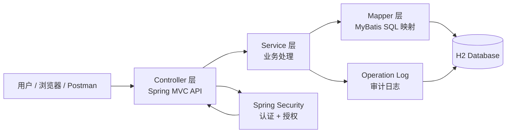
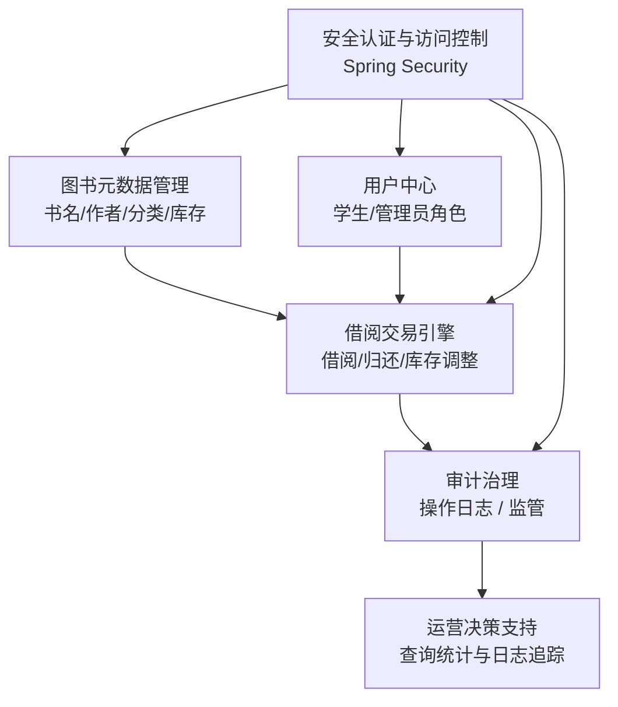
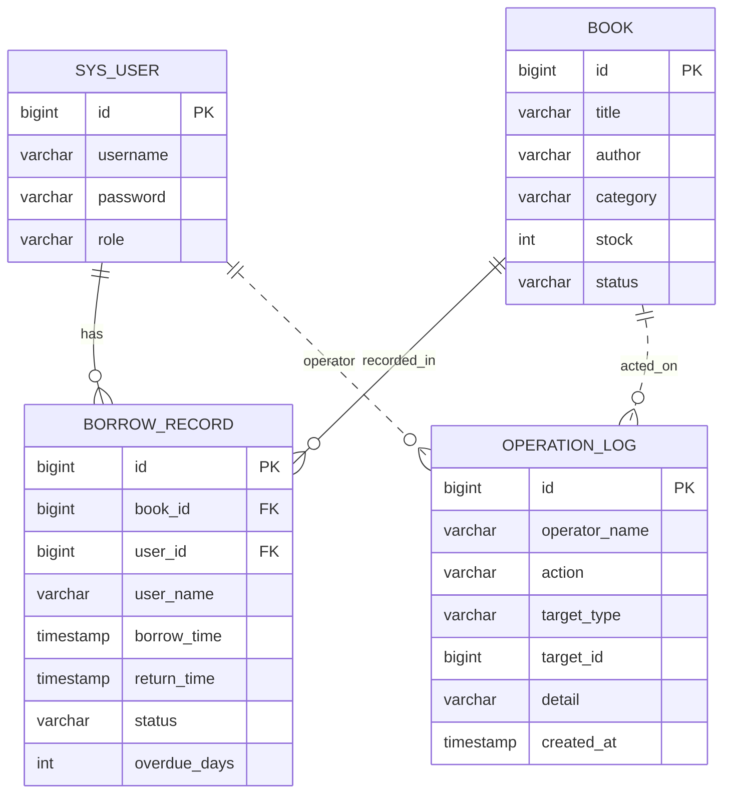

# 系统设计图（架构 + 数据库表）

## 1. 技术选型理由

### Spring Boot
- 适合快速搭建 Java Web 项目
- 自动装配能力强，减少 XML 配置
- 最适合学习型或课程型项目

### Spring MVC
- 负责接收 HTTP 请求并组织 REST API
- 与 Spring Boot 集成简单，便于开发接口

### MyBatis
- 映射 SQL 与 Java 对象更直接
- 适合需要控制 SQL 细节的学习项目
- 比传统 JDBC 更清晰，也比 JPA 更容易理解底层

### Spring Security
- 提供最基础的认证与授权能力
- 可通过角色控制保护接口
- 不引入复杂 JWT 方案，保持轻量

### H2 Database
- 内存数据库，启动迅速
- 非常适合教学和 Demo 场景
- 不需要额外安装 MySQL，降低准备成本

### 设计原则
- 适度简化：只保留核心功能，不做生产级扩展
- 模块分层：便于理解和后续扩展
- 可演示性：接口、数据、日志一目了然

## 2. 总体架构设计

### 说明
- Controller 层负责接收请求和输出结果
- Service 层封装业务流程，如借阅、归还、库存更新
- Mapper 层负责数据库交互
- Security 层负责资源访问控制
- 日志服务负责记录关键操作，形成审计闭环

## 3. 模块化协同视图（模拟全产业链思维）

### 产业链协同思维说明
- 图书元数据相当于“商品基础资产”
- 用户中心相当于“客户与角色管理”
- 借阅交易引擎相当于“核心交易流程”
- 审计治理相当于“品质控制与监管”
- 安全认证相当于“门禁与权限管理”
- 运营支持相当于“数据分析与决策”

这种结构把系统从单纯 API 组合提升为“业务闭环协同”的思维模型。

## 4. 数据库设计

### 4.1 实体关系图

### 4.2 数据表设计说明

#### sys_user
| 字段 | 类型 | 说明 |
|---|---|---|
| id | BIGINT | 用户主键 |
| username | VARCHAR(50) | 用户名 |
| password | VARCHAR(255) | 密码 |
| role | VARCHAR(20) | 角色：ADMIN / STUDENT |

#### book
| 字段 | 类型 | 说明 |
|---|---|---|
| id | BIGINT | 图书主键 |
| title | VARCHAR(200) | 书名 |
| author | VARCHAR(100) | 作者 |
| category | VARCHAR(50) | 分类 |
| stock | INT | 库存 |
| status | VARCHAR(20) | 状态：AVAILABLE / UNAVAILABLE |

#### borrow_record
| 字段 | 类型 | 说明 |
|---|---|---|
| id | BIGINT | 借阅记录主键 |
| book_id | BIGINT | 对应图书 |
| user_id | BIGINT | 借阅用户 |
| user_name | VARCHAR(50) | 用户名快照 |
| borrow_time | TIMESTAMP | 借出时间 |
| return_time | TIMESTAMP | 归还时间 |
| status | VARCHAR(20) | BORROWED / RETURNED |
| overdue_days | INT | 超期天数 |

#### operation_log
| 字段 | 类型 | 说明 |
|---|---|---|
| id | BIGINT | 日志主键 |
| operator_name | VARCHAR(50) | 操作人 |
| action | VARCHAR(50) | 行为：BORROW / RETURN / UPDATE |
| target_type | VARCHAR(50) | 目标类型 |
| target_id | BIGINT | 目标对象 ID |
| detail | VARCHAR(500) | 详细描述 |
| created_at | TIMESTAMP | 操作时间 |

## 5. 模块与职责划分

- Controller 层：接口暴露
- Service 层：业务规则及事务控制
- Mapper 层：数据库访问
- Security 层：认证授权
- Entity 层：数据模型
- H2：本地开发数据库

## 6. 关键流程设计

### 图书查询
- Request -> Controller -> BookService -> BookMapper -> DB

### 借阅
- Request -> Controller -> BorrowService -> BookMapper.reduceStock -> BorrowRecordMapper.insert -> OperationLogService.record

### 归还
- Request -> Controller -> BorrowService -> BorrowRecordMapper.updateReturnStatus -> BookMapper.increaseStock -> OperationLogService.record

## 7. 总结

本设计在轻量场景中保留了真实系统的核心结构：用户、图书、借阅、日志、权限、审计。通过模块化设计，项目不仅能运行，而且还能体现“产业链协同”的组织思维，便于学生理解系统如何从业务需求走向工程实现。

